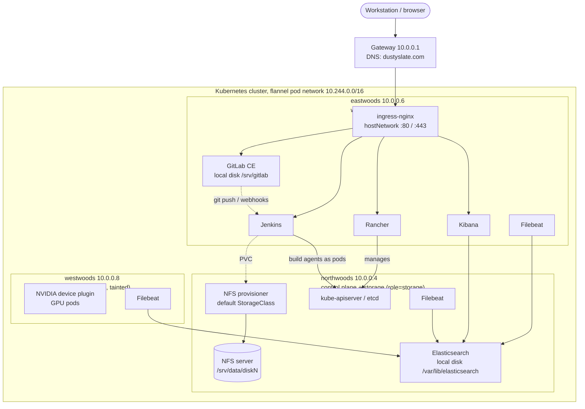

# Master install guide

End-to-end steps for building the install USB, bringing up the three-node Kubernetes cluster, and deploying GitLab, Jenkins, Rancher and the ELK logging stack.

Detailed notes live next to the scripts: [scripts/k8s/README.md](scripts/k8s/README.md) and [scripts/deployments/README.md](scripts/deployments/README.md). Cluster-wide settings are in [scripts/k8s/cluster.env](scripts/k8s/cluster.env) and [scripts/deployments/deployments.env](scripts/deployments/deployments.env).

## Final architecture



| Node | Cluster IP | Extra NIC IPs | Role | Runs |
|------|----|----|------|------|
| northwoods | 10.0.0.4 | .14 .24 .34 | control plane, storage | API server, NFS exports, NFS provisioner, Elasticsearch |
| eastwoods | 10.0.0.6 | .16 .26 .36 | web | ingress, GitLab, Jenkins, Rancher, Kibana |
| westwoods | 10.0.0.8 | .18 .28 .38 | GPU | NVIDIA device plugin, GPU workloads (tainted `nvidia.com/gpu`) |

Each node has four NICs on 10.0.0.0/24. NIC 0 (the default-route NIC) carries the cluster IP; the others carry the extra addresses and have no gateway.

Filebeat runs on every node. Service names are `gitlab.`, `jenkins.`, `rancher.` and `kibana.` under `dustyslate.com`, all resolving to eastwoods.

## Before you start

- Run all node scripts as root (`su -`), using `bash script.sh`. `sudo` is not assumed.
- The gateway is 10.0.0.1, and the network suffix is dustyslate.com.
- Create DNS records (or `/etc/hosts` entries on your workstation) for `gitlab`, `jenkins`, `rancher` and `kibana` pointing to 10.0.0.6.
- eastwoods needs enough RAM for GitLab (4 GB or more), Jenkins, Rancher and Kibana together.

## Phase 1: build the install USB

On the machine where you build the stick:

1. Get the ISO. The default is `debian-13.8.0-amd64-netinst.iso`.

   ```bash
   bash scripts/download-iso.sh
   ```

2. Write the stick. It makes a bootable installer partition and a `SCRIPTS` partition with the post-install, sid upgrade, `k8s/` and `deployments/` scripts. This erases the device.

   ```bash
   bash scripts/create-usb.sh /dev/sdX
   ```

3. Check the device.

   ```bash
   bash scripts/verify-usb.sh /dev/sdX
   ```

## Phase 2: install Debian on each node

Repeat for northwoods, eastwoods and westwoods.

1. Boot from the USB and install Debian 13.
2. Log in as root, then mount the `SCRIPTS` partition (second partition on the stick):

   ```bash
   mount /dev/sdX2 /mnt
   cd /mnt
   ```

3. Set the hostname and install base packages. Pick the node name from the menu.

   ```bash
   bash post-install.sh
   ```

4. Optional: upgrade to Debian sid (needed on westwoods for the NVIDIA driver packages if you rely on sid). Reboot afterwards.

   ```bash
   bash upgrade-to-sid.sh
   reboot
   ```

5. Assign the static IPs to all four NICs (shows the plan and asks first), then reboot.

   ```bash
   cd /mnt/k8s
   bash 00-set-static-ip.sh
   reboot
   ```

## Phase 3: storage on northwoods

Do this before the deployments, which need the NFS directory.

```bash
cd /mnt/k8s
bash 06-setup-storage-node.sh /dev/sdb /dev/sdc   # erases the listed disks
```

This formats and mounts each disk at `/srv/data/diskN`, exports them over NFS, and creates `/srv/data/disk1/k8s`.

## Phase 4: Kubernetes cluster

1. **All nodes:** prepare the OS and install containerd and kubeadm.

   ```bash
   bash 01-prep-node.sh
   ```

2. **northwoods:** initialize the control plane. Use your normal username so it gets `~/.kube/config`. Copy the printed `kubeadm join ...` line.

   ```bash
   bash 02-init-control-plane.sh clint
   ```

3. **eastwoods and westwoods:** join the cluster.

   ```bash
   bash 03-join-node.sh "kubeadm join 10.0.0.4:6443 --token ... --discovery-token-ca-cert-hash sha256:..."
   ```

4. **northwoods:** label the nodes, taint the GPU node, and allow workloads on the control plane. Run as your normal user.

   ```bash
   bash 04-label-nodes.sh
   ```

5. **westwoods:** install the NVIDIA driver and container toolkit, then reboot and check `nvidia-smi`. The non-free apt component must be enabled first.

   ```bash
   bash 05-setup-gpu-node.sh
   reboot
   ```

6. **northwoods:** apply the GPU device plugin.

   ```bash
   kubectl apply -f manifests/nvidia-device-plugin.yaml
   ```

Verify:

```bash
kubectl get nodes -o wide
kubectl describe node westwoods | grep -i nvidia.com/gpu
showmount -e northwoods
```

## Phase 5: platform and deployments

Run from northwoods as your normal user, in `scripts/deployments/`.

| Step | Command | Result |
|------|---------|--------|
| 1 | `bash 01-platform.sh` | helm, ingress-nginx on eastwoods, cert-manager, NFS default StorageClass |
| 2 | `bash 02-gitlab.sh` | GitLab CE; prints the initial root password |
| 3 | `bash 03-jenkins.sh` | Jenkins LTS; prints the initial admin password |
| 4 | `bash 04-rancher.sh` | Rancher; prints the bootstrap password |
| 5 | `bash 05-elk.sh` | Elasticsearch, Kibana, Filebeat; prints the `elastic` password |
| 6 | `bash 06-elk-retention.sh` | Deletes logs older than `RETENTION_DAYS` (default 14) |

After step 5, create a Kibana data view for `filebeat-*`.

## Order at a glance

```mermaid
flowchart LR
    A[Build USB] --> B[Install Debian<br/>post-install.sh]
    B --> C[sid upgrade, reboot<br/>optional]
    C --> D[00 static IP, reboot]
    D --> E[06 storage<br/>northwoods]
    E --> F[01 prep<br/>all nodes]
    F --> G[02 init<br/>northwoods]
    G --> H[03 join<br/>eastwoods, westwoods]
    H --> I[04 label nodes]
    I --> J[05 GPU setup<br/>westwoods]
    J --> K[GPU device plugin]
    K --> L[deployments 01-06]
```



## Known open items

- Kubernetes version `v1.33` in `cluster.env` may be out of support; pick a current release.
- ingress-nginx has been announced as retired; consider another ingress controller.
- GitLab's readiness probe may need the pod network added to its monitoring allowlist.
- No backups yet for GitLab, Jenkins, Elasticsearch or etcd, and the control plane is a single node.
- Services use plain HTTP except Rancher (self-signed cert).
- NFS exports use `no_root_squash` for the whole `10.0.0.0/24`.
- `create-usb.sh` uses `sudo -A`, and the installer partition may need boot code to start on some machines.
